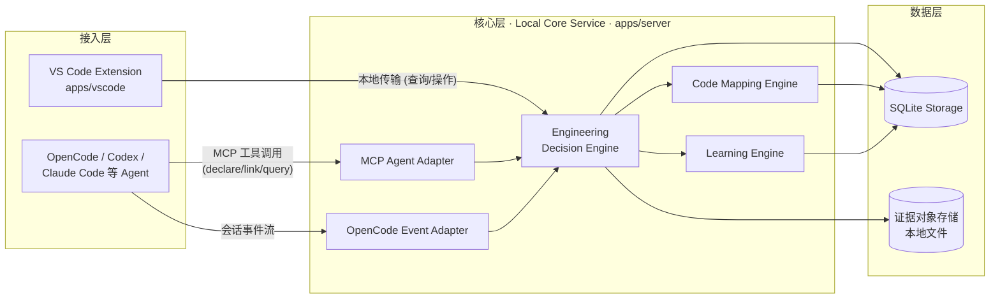
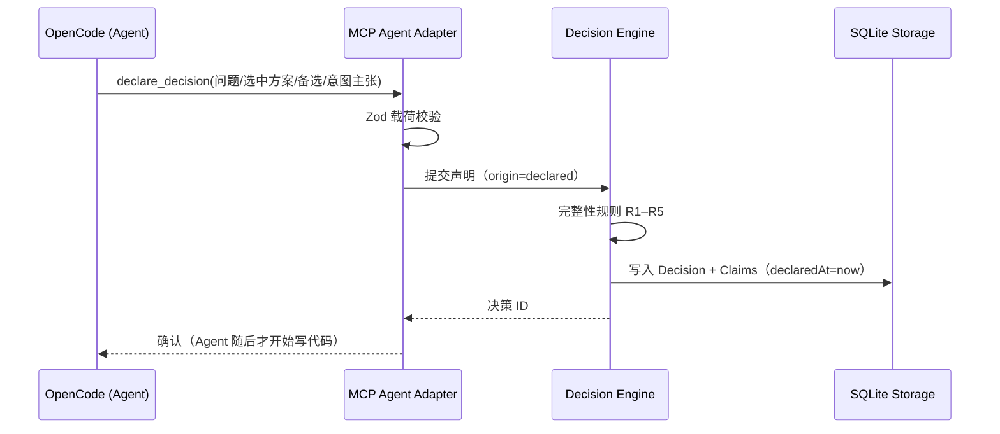
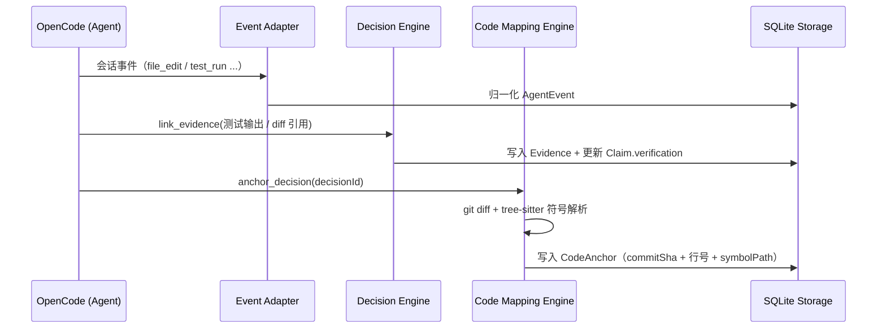
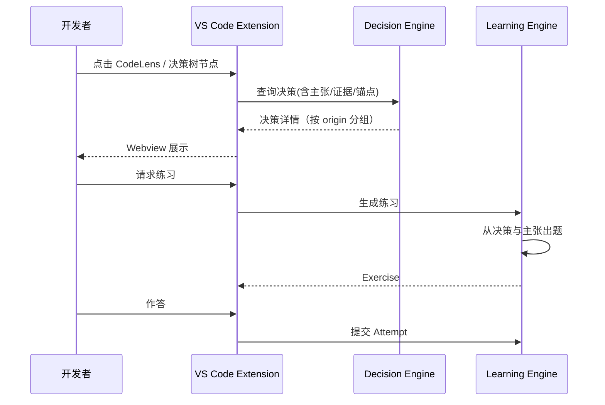

# CodeMentor 系统架构

状态：v0.1（阶段 0 产出） · 数据契约见 docs/CONTRACTS.md · 决策记录见 docs/decisions/

## 1. 总体形态

CodeMentor 由三层构成：

- **接入层**：VS Code 扩展（人机界面）+ MCP 服务（Agent 接入）+ OpenCode 事件适配器（事实采集）。
- **核心层**：本地 Node.js 服务进程，承载决策引擎、代码映射引擎、学习引擎。
- **数据层**：SQLite 存储 + 本地对象存储（证据内容）。

核心原则：**业务逻辑全部在核心层，接入层只做转译**。核心层不知道 VS Code API，也不知道 OpenCode 的私有格式，因此可以在无 IDE、无 Agent 的环境下被完整测试。

## 2. 模块职责

| 模块                                                     | 阶段 | 状态       | 职责                                                                                         | 不负责                 |
| -------------------------------------------------------- | ---- | ---------- | -------------------------------------------------------------------------------------------- | ---------------------- |
| VS Code Extension (`apps/vscode`)                        | 4    | ✅         | 纯视图层：决策树 / 详情 Webview / CodeLens / 跳转（ADR-0007）                                | 任何业务规则、存储     |
| Local Core Service (`apps/server`)                       | 1    | ✅         | 核心进程：装载引擎与存储、回环 HTTP + token 传输（ADR-0004）                                 | UI、Agent 私有格式解析 |
| MCP Agent Adapter (`packages/mcp`*)                      | 2    | 计划       | 把核心层能力暴露为 MCP 工具（mentor_* 五工具）；经核心服务 API 落库                          | 决策规则本身           |
| OpenCode Event Adapter                                   | 2    | 计划       | 订阅 OpenCode 事件，归一化为 AgentEvent                                                      | 其他 Agent 的私有格式  |
| Engineering Decision Engine (`packages/decision-engine`) | 1/5  | ✅（基础） | 决策生命周期管理；完整性规则 R1–R5（verify 前瞻检查）；declaredAt 服务端盖章                 | 界面呈现               |
| Code Mapping Engine (`packages/code-mapping`)            | 3    | ✅         | Tree-sitter 符号解析（C，可扩展）+ 只读 Git 分析；锚定/重定位/失效检测/提案（ADR-0005/0006） | 决策语义               |
| Learning Engine (`packages/learning-engine`)             | 5    | ✅         | 确定性模板生成五步学习流；规则评分（gradedBy 治理）；进度由 Attempt 派生（ADR-0008）         | 出题之外的 AI 调用     |
| SQLite Storage (`packages/storage`)                      | 1    | ✅         | better-sqlite3 持久化、索引、版本化迁移（ADR-0003）                                          | 跨仓共享               |

\* 包路径以阶段 2 设计为准，此处先锁定职责。API 细节见 docs/LOCAL_API.md。

## 3. 架构图

依赖方向（编译期）：所有模块依赖 `@codementor/contracts`（数据契约与完整性规则）；引擎不依赖任何接入层。contracts 是整个系统唯一的共享内核，这保证了"文档即契约、契约即代码"。

## 4. 主要数据流

### 4.1 决策声明（Agent 动手之前）

### 4.2 事实采集与代码锚定（Agent 实现之后）

### 4.3 理解与练习（开发者）

## 5. 关键设计约束

1. **契约优先**：`@codementor/contracts`（Zod schema + 完整性规则）是唯一被所有层共享的模块；跨模块数据必须先过契约校验。
2. **认知来源不可自动升级**：`rationalized → declared` 的转换被系统禁止；只有带可信时间戳的新声明才产生 `declared` 记录。
3. **进程边界**：VS Code 扩展崩溃不应影响核心服务；核心服务必须能在无扩展时被 Agent 独立使用（headless）。
4. **本地传输**：扩展/适配器 ↔ 服务走 `127.0.0.1` HTTP + Bearer token，端口与 token 经 `<CODEMENTOR_HOME>/server.json` 发现（ADR-0004）；不监听外网地址。

## 6. 阶段映射

| 阶段        | 交付模块                                                        |
| ----------- | --------------------------------------------------------------- |
| 0（本阶段） | contracts 契约包 + 仓库骨架 + CI                                |
| 1           | SQLite Storage + Local Core Service 骨架 + Decision Engine 基础 |
| 2           | MCP Agent Adapter + OpenCode Event Adapter                      |
| 3           | Code Mapping Engine（Git + Tree-sitter）                        |
| 4           | VS Code Extension                                               |
| 5           | Learning Engine + Exercise/Attempt                              |
| 6           | 集成打磨与开源发布                                              |
