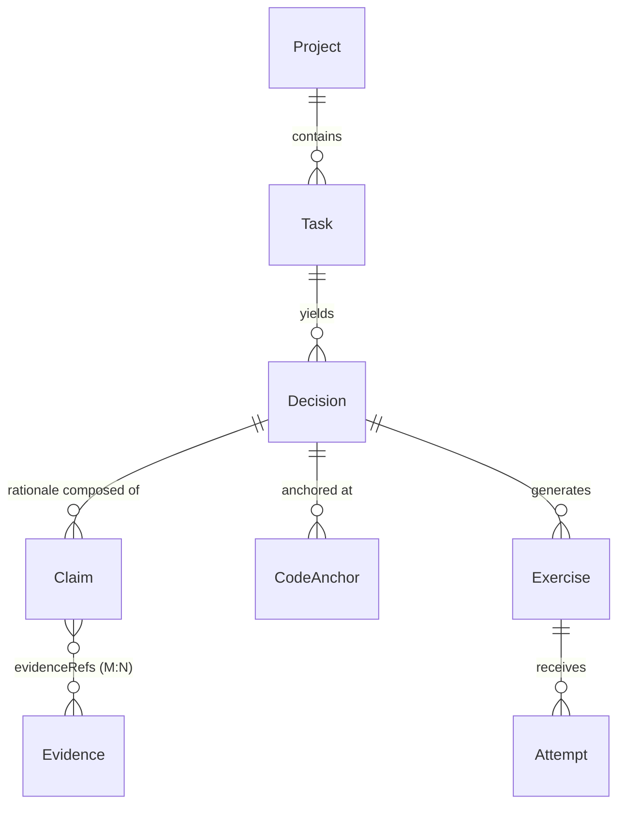

# CodeMentor 数据契约

状态：v0.1（阶段 0 产出） · 可执行实现：`packages/contracts`（本文档与代码字段一一对应）

本契约是整个系统的规范源。任何模块写入或读取这些实体时，都必须通过 `@codementor/contracts` 的 Zod schema 校验。

## 0. 核心分类学：主张的认知来源

系统中最重要的一条设计是给每条**主张（Claim）**标注认知来源：

| origin         | 含义                 | 产生时机                 | 可信度依据                                             |
| -------------- | -------------------- | ------------------------ | ------------------------------------------------------ |
| `declared`     | 明确声明的设计意图   | 代码产生**之前**         | `declaredAt` 时间戳 + 完整性规则 R5 保证"先声明后实现" |
| `observed`     | 从世界测量得到的事实 | 任意时刻（通常在实现后） | 必须引用 Evidence（R3），验证状态随证据更新            |
| `rationalized` | 事后补写的解释       | 代码产生**之后**         | 不可验证；**永远不会被系统自动升级为 declared**        |

这三类信息回答了"AI 编码前明确声明的设计意图、已观察到的代码和测试事实、AI 事后推断的技术理由"如何区分的问题：它们是同一实体的三个枚举值，被同一套完整性规则约束，在 UI 中以不同置信度呈现。

## 1. 通用约定

- ID：不透明非空字符串，由存储层生成（v0.1 不约束格式）。
- 时间戳：ISO 8601 UTC，必须以 `Z` 结尾（禁止时区偏移），因此可按字符串字典序比较。
- `commitSha`：40 位小写 git SHA-1。
- `filePath`：POSIX 风格仓库相对路径（不以 `/` 开头、不含 `\`）。
- 标注 `default` 的字段缺省时可省略。

## 2. 实体定义

### 2.1 Project —— 记录作用域

一条仓库对应一条 Project；所有实体最终归属某个 Project。

| 字段      | 类型      | 约束                 |
| --------- | --------- | -------------------- |
| id        | string    | 非空，主键           |
| name      | string    | 非空                 |
| rootPath  | string    | 非空，工作区绝对路径 |
| createdAt | timestamp | UTC ISO              |

存在意义：决策必须挂在实际仓库上才有代码锚定的可能；Project 是归档、清理与多仓隔离的单位。

### 2.2 Task —— Agent 工作单元

| 字段      | 类型       | 约束                                       |
| --------- | ---------- | ------------------------------------------ |
| id        | string     | 非空，主键                                 |
| projectId | string     | 外键 → Project.id                          |
| title     | string     | 非空                                       |
| goal      | string     | 可为空串                                   |
| status    | enum       | `planned / active / completed / abandoned` |
| startedAt | timestamp  | UTC ISO                                    |
| endedAt   | timestamp? | 结束后填入                                 |

存在意义：决策按任务分组才符合开发者的工作语境（"这次改配置模块时做了哪些选择"）。

### 2.3 Decision —— 核心制品：一次设计选择

| 字段               | 类型                | 约束                                                     |
| ------------------ | ------------------- | -------------------------------------------------------- |
| id                 | string              | 非空，主键                                               |
| projectId / taskId | string              | 外键                                                     |
| question           | string              | 非空；要回答的设计问题                                   |
| title              | string              | 非空                                                     |
| chosenOption       | string              | 非空；选中的方案                                         |
| alternatives       | `{name, summary}[]` | default `[]`；被记录但未选择的路线                       |
| status             | enum                | `draft / declared / implemented / verified / superseded` |
| decidedBy          | enum                | `agent / human / pair`                                   |
| declaredAt         | timestamp           | **声明时刻，真实性锚点**                                 |

存在意义：把"为什么"从聊天记录提升为可查询、可验证、可锚定到代码的一等公民。

### 2.4 Claim —— 原子主张

| 字段         | 类型      | 约束                                                     |
| ------------ | --------- | -------------------------------------------------------- |
| id           | string    | 非空，主键                                               |
| decisionId   | string    | 外键 → Decision.id                                       |
| kind         | enum      | `constraint / tradeoff / risk / benefit`                 |
| origin       | enum      | `declared / observed / rationalized`（见第 0 节）        |
| statement    | string    | 非空                                                     |
| verification | enum      | `unverified / supported / refuted`，default `unverified` |
| evidenceRefs | string[]  | default `[]`；引用 Evidence.id                           |
| createdAt    | timestamp | UTC ISO                                                  |

存在意义：决策的理由不是一整段话，而是可分别验证、可分别被证据反驳的原子命题。"启动更快"和"便于排查"必须拆开，因为它们的证据不同。

### 2.5 CodeAnchor（v0.2）—— 决策到代码的稳定指针

| 字段                | 类型      | 约束                                                      |
| ------------------- | --------- | --------------------------------------------------------- |
| id                  | string    | 非空，主键                                                |
| decisionId          | string    | 外键                                                      |
| filePath            | path      | 仓库相对路径（重定位可能更新，如跟随 git 重命名）         |
| symbolPath          | string[]  | **必填**；符号链如 `["ConfigStore","load"]`，末位为定位键 |
| symbolKind          | enum      | `function / struct / typedef / other`                     |
| startLine / endLine | int       | 正整数，start ≤ end（最后已知位置；missing 时保留）       |
| contentHash         | sha-256   | 符号源文本哈希（行尾归一 LF），检测内容漂移               |
| commitSha           | sha1      | 锚定/最近一次确认时的 HEAD（版本信息）                    |
| status              | enum      | `confirmed / ambiguous / missing`，default `confirmed`    |
| origin              | enum      | `declared / inferred`（关联来源，见下）                   |
| anchoredAt          | timestamp | 锚定时刻（服务端时钟）                                    |

存在意义与状态语义（详见 ADR-0006）：

- **confirmed**：符号唯一解析成功，行范围与当前内容一致。
- **ambiguous**：无法精确定位（条件编译同名多定义、语法错误、无解析器的扩展名）——不更新位置，绝不展示可能错误的位置。
- **missing**：文件或符号已不存在——记录与最后已知位置保留，绝不删除、绝不凭空造符号、绝不做跨文件猜测式回退。

关联来源：`declared`（Agent/人显式声明）与 `inferred`（自动匹配被接受后落库，展示必须标注）。自动提案（proposeAnchors）只产出候选、不落库。

时间语义：本实体从不读取文件修改时间；版本信息只来自 git commit，时间只来自服务端时钟。

认知三角的落点：**符号存在**=observed 事实（解析结果）；**决策↔符号关联**=anchor.origin 标注的判断；**设计理由推断**=Claim(origin=rationalized)。三层互不冒充。

### 2.6 Evidence —— 机器可核查的制品

| 字段       | 类型      | 约束                                                      |
| ---------- | --------- | --------------------------------------------------------- |
| id         | string    | 非空，主键                                                |
| kind       | enum      | `test_run / diff / build_log / agent_event / manual_note` |
| verdict    | enum      | `pass / fail / unknown`                                   |
| producedAt | timestamp | 事实产生时刻（非登记时刻）                                |
| producedBy | enum      | `agent / human / ci`                                      |
| contentRef | string    | 非空；本地对象存储引用（路径或哈希），非外链              |
| summary    | string    | default `''`                                              |

存在意义：让"理由"与"事实"分离——主张可以错，证据不会说谎。`producedAt` 支撑 R5 时序规则。

### 2.7 AgentEvent —— 归一化事件流

| 字段       | 类型      | 约束                                                                               |
| ---------- | --------- | ---------------------------------------------------------------------------------- |
| id         | string    | 非空，主键                                                                         |
| sessionId  | string    | Agent 会话标识                                                                     |
| agent      | enum      | `opencode / codex / claude-code / generic`                                         |
| type       | enum      | `session_start / session_end / tool_call / file_edit / test_run / message / other` |
| payload    | record    | 保留原始结构的 JSON 对象                                                           |
| occurredAt | timestamp | UTC ISO                                                                            |

存在意义：原始事件是观察类证据的上游；统一 schema 使核心层无需了解各 Agent 的私有格式（厂商中立的第一道防线）。

### 2.8 Exercise —— 从决策派生的练习

| 字段          | 类型      | 约束                                                                    |
| ------------- | --------- | ----------------------------------------------------------------------- |
| id            | string    | 非空，主键                                                              |
| decisionId    | string    | 外键；练习必须可追溯到源决策                                            |
| type          | enum      | `explain_choice / predict_impact / alternative_tradeoff / design_drill` |
| prompt        | string    | 非空                                                                    |
| focusClaimIds | string[]  | default `[]`；重点考察的主张                                            |
| createdAt     | timestamp | UTC ISO                                                                 |

### 2.9 Attempt —— 作答记录

| 字段        | 类型      | 约束                                                   |
| ----------- | --------- | ------------------------------------------------------ |
| id          | string    | 非空，主键                                             |
| exerciseId  | string    | 外键                                                   |
| answer      | string    | 非空                                                   |
| outcome     | enum      | `ungraded / pass / partial / fail`，default `ungraded` |
| feedback    | string    | default `''`                                           |
| submittedAt | timestamp | UTC ISO                                                |

存在意义：学习效果必须可度量。Attempt 历史 + 决策覆盖情况是"我是否真的在成长"的客观依据。

## 3. 实体关系

（AgentEvent 独立于决策图，作为观察类 Evidence 的上游存在。）

## 4. 完整性规则（不变式）

实现：`packages/contracts/src/integrity.ts` 的 `validateDecisionIntegrity()`。规则编号与代码中的 `IntegrityIssueCode` 一致。

| 规则                                                                   | 编号                                     | 含义                                         |
| ---------------------------------------------------------------------- | ---------------------------------------- | -------------------------------------------- |
| 每条 Decision 至少含一条 `declared` 主张                               | `missing-declared-claim`                 | 只有事后解释的"决策"不是设计决策，是重构叙事 |
| 主张只能引用存在的 Evidence                                            | `unknown-evidence-ref`                   | 防止悬空引用                                 |
| `observed` 主张必须引用至少一条证据                                    | `observed-claim-without-evidence`        | 观察事实不允许无出处                         |
| `verified` 决策必须存在"已支撑（supported）且带证据"的 `observed` 主张 | `verified-without-supported-observation` | 验证状态由事实授予，不由口头理由授予         |
| `declaredAt` 不得晚于其 `observed` 证据的最早 `producedAt`             | `declared-after-evidence`                | 声明必须先于实现证据，否则是事后补写         |

## 5. v0.2 候选演进（本阶段不实现）

- 备选方案的否决理由结构化（当前为自由文本 summary）。
- SHA-256 仓库的 commitSha 支持。
- 主张之间的依赖/冲突关系。
